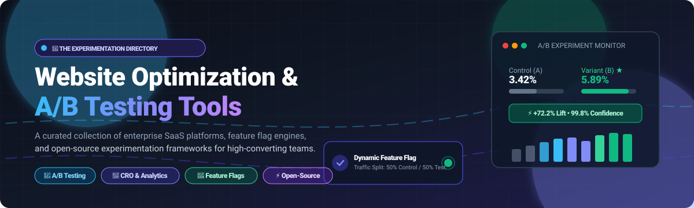

  

# 🚀 Awesome Website Optimization & A/B Testing 🧪

> 💡 A curated, high-impact directory of the best **Website Optimization, A/B Testing, Feature Flagging, and Conversion Rate Optimization (CRO)** platforms — covering enterprise SaaS/hosted solutions and top open-source tools for digital experimentation, multivariate testing, and product analytics.

🌟 **Star this repo if you find it useful for your experimentation and optimization tech stack!** 🌟

---

## 📋 Table of Contents

- [📈 Sector Overview & Market Dynamics](#-sector-overview--market-dynamics)
- [🟦 SaaS / Hosted Platforms](#-saas--hosted-platforms)
- [🟩 Open-Source Software](#-open-source-software)
- [📊 Feature Comparison Matrix](#-feature-comparison-matrix)
- [🔍 Key Evaluation Criteria for CRO & Testing Tools](#-key-evaluation-criteria-for-cro--testing-tools)
- [💖 Support & Sponsorship](#-support--sponsorship)
- [🌟 Star History](#-star-history)
- [🤝 Contributing](#-contributing)
- [📄 License](#-license)

---

## 📈 Sector Overview & Market Dynamics 🌐

The global **A/B Testing and Digital Experience Optimization software market** is estimated at approximately **$1.1 billion to $1.6 billion** (expanding toward **$3.5B+ to $4.8B** by the mid-2030s at an estimated CAGR of **12% to 15%**).

The market exhibits **moderate-to-high fragmentation**:
- 🏢 **Enterprise & MarTech Consolidation:** At the high end, full-stack Digital Experience Platforms (DXPs) such as Optimizely, Dynamic Yield (Mastercard), and Wingify (which merged VWO and AB Tasty) dominate enterprise conversion optimization and multi-channel personalization.
- 🛠️ **Product-Led & Developer Fragmentation:** Concurrently, rapid innovation across developer tooling, open-source feature flagging (e.g., PostHog, GrowthBook, Unleash), and warehouse-native analytics prevents "winner-take-all" concentration, enabling specialized, agile, and privacy-first self-hosted alternatives to capture substantial market share.

---

## 🟦 SaaS / Hosted Platforms ☁️

Below is a detailed breakdown of leading commercial Website Optimization and A/B Testing platforms, **sorted in descending order by company scale** (annual revenue / enterprise valuation).

| 🏢 Platform | 💰 Company Scale (Revenue / Valuation) | 💳 Starting Pricing (Paid Tiers) | 🎁 Free Tier / Free Trial Limits | 🎯 Key Optimization Capabilities & Focus |
|:---|:---|:---|:---|:---|
| **[Zoho PageSense](https://www.zoho.com/pagesense/)** | **~$1.5B Revenue** / ~$12.5B Valuation *(Zoho Corp)* | **$16/mo** (Engage tier, 10k MTU; billed annually) / **$30/mo** (Optimize/Enterprise tier for A/B testing) | **Free Forever plan**: 5,000 Monthly Tracked Users (MTUs), 1 project, 1 month data retention; includes heatmaps, session recordings, conversion goals, and form analytics. *(15-day free trial for paid tiers)* | Conversion rate optimization suite integrated within the Zoho ecosystem; heatmaps, session replays, funnel analysis, and visual A/B testing. |
| **[Dynamic Yield](https://www.dynamicyield.com/)** | **~$98M Revenue** / Acquired for $327M *(Mastercard)* | **~$35,000/year** (Enterprise contract model; ~**$2,900/mo** billed annually) | **No free tier & no self-serve free trial**; evaluation requires sales-led enterprise demo and custom sandbox scoping. | Omnichannel personalization engine (Experience OS), algorithm-driven product recommendations, predictive segmentation, and cross-device A/B/n testing. |
| **[Optimizely](https://www.optimizely.com/)** | **~$400M ARR** / Acquired for $1.16B *(Insight Partners)* | **~$36,000 to $40,000/year** (Web Experimentation entry tier; ~**$3,000 to $3,330/mo** billed annually) | **No free tier & no self-serve free trial**; access requires custom sales demo, technical scoping, and enterprise pilot agreement. | Enterprise standard for client-side and full-stack server-side experimentation, multi-page testing, Bayesian statistics, and digital experience governance. |
| **[VWO](https://vwo.com/)** | **~$100M+ Combined Rev** / ~$500M Combined Val *(Wingify Group)* | **~$198 to $356/mo** (VWO Testing Growth tier, 10k–50k MTUs; billed annually) | **30-day free trial**: Full access to VWO Testing, heatmaps, and funnel analytics (up to 10k–50k test visitor allotment, no credit card required). Free forever plan retired. | All-in-one experimentation suite combining visual code-free editor, heatmaps, click maps, session replays, behavioral surveys, and multivariate testing. |
| **[AB Tasty](https://www.abtasty.com/)** | **~$100M+ Combined Rev** / Merged with Wingify / ~$500M Val | **~$1,000 to $3,300/mo** (Entry modular package; billed annually at ~$12k–$40k/yr) | **No public self-serve free tier or free trial**; evaluations managed via custom demo and guided enterprise trial sandbox. | Client-side visual experimentation, server-side API flag management (Flagship), dynamic widgets, predictive segmentation, and multi-armed bandit allocation. |
| **[Unbounce](https://unbounce.com/)** | **~$35M–$50M Revenue** / ~$350M Valuation | **$29/mo** (Starter plan; $22/mo billed annually); **$99–$149/mo** for dedicated Smart Traffic and A/B testing tiers | **14-day free trial**: Access to drag-and-drop page builder and AI copywriting; requires sign-up (no credit card required upfront on starter trial). | Landing page builder with built-in A/B split testing, AI conversion intelligence (Smart Traffic machine-learning router), and lead capture popups/sticky bars. |
| **[Kameleoon](https://www.kameleoon.com/)** | **~$22M Revenue** / ~$330M Valuation | **$495/mo** (Prompt-Based Experimentation / PBX Starter tier, up to 50k MTUs) | **30-day free trial**: Capped at 3 experiments (10 trial generation credits) and 5,000 MTUs without code installation or credit card. | Privacy-first experimentation platform (HIPAA, GDPR, CCPA native), AI predictive personalization, and natural language Prompt-Based Experimentation. |
| **[Instapage](https://instapage.com/)** | **~$19M–$21M Revenue** / Acquired by airSlate | **$99/mo** (Create plan; $79/mo billed annually); custom quotes for Enterprise A/B testing suite | **14-day free trial**: Capped at 2,500 unique visitors during the trial period; requires credit card upfront (auto-converts if not canceled). | High-converting landing page platform featuring server-side A/B/n split testing, AdMap 1:1 ad-to-page personalization, and collaborative page design. |
| **[Crazy Egg](https://www.crazyegg.com/)** | **~$4.5M Revenue** / Founder-bootstrapped | **$29/mo** (Starter plan: 30k tracked pageviews/mo; billed annually at $348/yr) | **30-day free trial**: Includes 30k tracked pageviews, unlimited heatmaps, and recordings; requires credit card upfront (auto-bills annually unless canceled). | Visual analytics pioneer providing click heatmaps, scroll maps, confetti click segmentation, session replay recordings, and lightweight visual A/B testing. |

---

## 🟩 Open-Source Software 🔓

Self-hosted, transparent, and community-driven experimentation and website optimization software. Projects are **sorted in descending order by GitHub stargazers count**.

| 💻 Project | ⭐ Stars | 🛠️ Tech Stack | 📜 License | 📝 Description & Capabilities |
|:---|:---:|:---|:---|:---|
| **[PostHog](https://github.com/PostHog/posthog)** |  | Python / ClickHouse / React / TypeScript | PostHog Open Source / Source Available | Unified product analytics and experimentation platform. Features native A/B and multivariate experimentation, feature flags, session replays, funnel analysis, and survey feedback. |
| **[Unleash](https://github.com/Unleash/unleash)** |  | Node.js / TypeScript / PostgreSQL | Apache-2.0 | Battle-tested enterprise feature toggle and experimentation management engine. Provides local SDK evaluation for sub-millisecond response, percentage split rollouts, and variant targeting. |
| **[OpenReplay](https://github.com/openreplay/openreplay)** |  | Go / Python / TypeScript / Docker | Open Source (ELv2) | Self-hosted session replay, heatmaps, and product performance analytics. Essential CRO companion that surfaces friction points, user struggle signals, and why experimental variants win or lose. |
| **[GrowthBook](https://github.com/growthbook/growthbook)** |  | TypeScript / Next.js / MongoDB | MIT (Core) | Warehouse-native A/B testing and feature flagging platform. Computes Bayesian/frequentist statistics, CUPED variance reduction, and multi-armed bandits directly inside Snowflake, BigQuery, ClickHouse, or Postgres. |
| **[Flagsmith](https://github.com/Flagsmith/flagsmith)** |  | Python / Django / PostgreSQL / React | BSD-3-Clause | Open-source feature flag and remote configuration platform with multivariate testing, user segment targeting, and seamless integrations with external analytics platforms. |
| **[Flagger](https://github.com/fluxcd/flagger)** |  | Go / Kubernetes CRDs | Apache-2.0 | Progressive delivery Kubernetes operator automating A/B testing, Canary deployments, and Blue/Green rollouts using service meshes (Istio, Linkerd) and ingress traffic routers. |
| **[FeatBit](https://github.com/featbit/featbit)** |  | .NET / C# / TypeScript / MongoDB | MIT | Enterprise-grade, 100% self-hosted feature management and experimentation platform. Offers real-time feature flag evaluation, traffic splitting, and metric tracking. |
| **[Sixpack](https://github.com/sixpack/sixpack)** |  | Python / Redis | BSD-2-Clause | Language-agnostic A/B testing framework developed by SeatGeek. Runs via an HTTP REST API and client-side libraries in JavaScript, Python, PHP, Ruby, and Go. |
| **[Bucketeer](https://github.com/bucketeer-io/bucketeer)** |  | Go / MySQL / Redis / gRPC | Apache-2.0 | Scalable feature flag and experimentation service built by CyberAgent, evaluated on 100M+ users. Features audit logging, OpenFeature compatibility, stale flag alerts, and multi-variant assignment. |
| **[Localess](https://github.com/Lessify/localess)** |  | TypeScript / Angular / Firebase | AGPL-3.0 | Modern headless CMS and visual translation tool with built-in A/B testing, multi-language version experiments, and site content analytics. |
| **[Controlvar](https://github.com/Controlvar/controlvar)** |  | FastAPI / PostgreSQL / Redis | Apache-2.0 | Lightweight self-hosted A/B testing framework supporting frequentist, Bayesian, sequential testing, CUPED variance reduction, and multi-armed bandit rollouts. |
| **[oss-clarity](https://github.com/meharaj-007/oss-clarity)** |  | Python / Django / rrweb | MIT | Self-hosted session replay, click heatmaps, and behavioral struggle signals (rage clicks, dead clicks, form abandons) for Django web applications. |

---

## 📊 Feature Comparison Matrix ⚖️

| 🛠️ Platform / Tool | 🏷️ Type | 📜 License | 🎨 Visual Editor | ⚡ Server-Side SDKs | 📐 Statistical Engine | 📹 Behavioral Replay / Heatmaps | 🏠 Self-Hosted Option | 🎯 Primary Target Audience |
|:---|:---|:---|:---:|:---:|:---|:---:|:---:|:---|
| **Zoho PageSense** | CRO Suite | Proprietary | ✅ | ❌ | Frequentist | ✅ Native | ❌ | SMBs & Zoho ecosystem users |
| **Dynamic Yield** | Personalization | Proprietary | ✅ | ✅ | Advanced Bayesian / ML | ❌ (Integration) | ❌ | Enterprise eCommerce & Omnichannel |
| **Optimizely** | DXP Experimentation | Proprietary | ✅ | ✅ | Stats Engine (Sequential) | ❌ (Integration) | ❌ | Enterprise experimentation teams |
| **VWO** | CRO Suite | Proprietary | ✅ | ✅ | SmartStats (Bayesian) | ✅ Native | ❌ | Mid-market to Enterprise marketing |
| **AB Tasty** | CRO & Personalization| Proprietary | ✅ | ✅ | Bayesian & Bandits | ❌ (Integration) | ❌ | Mid-market product & growth teams |
| **Unbounce** | Landing Page Builder | Proprietary | ✅ | ❌ | Smart Traffic (Bandit) | ❌ | ❌ | Performance marketers & PPC teams |
| **Kameleoon** | CRO & Feature Flags | Proprietary | ✅ | ✅ | Frequentist & Bayesian | ❌ (Integration) | ❌ | Regulated industries (HIPAA/GDPR) |
| **Instapage** | Landing Page Builder | Proprietary | ✅ | ❌ | Frequentist Split Test | ✅ Heatmaps | ❌ | Ad-spend performance marketers |
| **Crazy Egg** | CRO Analytics | Proprietary | ✅ (Basic) | ❌ | Frequentist Split Test | ✅ Native | ❌ | Website owners, SMBs & agencies |
| **PostHog** | Product Analytics | Source-Available | ❌ | ✅ | Frequentist & Bayesian | ✅ Native | ✅ | Full-stack developers & growth PMs |
| **Unleash** | Feature Flags | Apache-2.0 | ❌ | ✅ | Percentage Traffic Split | ❌ | ✅ | Platform engineering & DevOps |
| **OpenReplay** | Behavioral Analytics| Open Source | ❌ | ❌ | N/A (Diagnostic) | ✅ Native | ✅ | Security-conscious web developers |
| **GrowthBook** | Warehouse Experiment | MIT (Core) | ✅ (Extension) | ✅ | Bayesian, Frequentist, CUPED | ❌ (Integration) | ✅ | Data teams & warehouse-first orgs |
| **Flagsmith** | Feature Flags | BSD-3-Clause | ❌ | ✅ | Multivariate Split | ❌ | ✅ | App developers & engineering teams |
| **Flagger** | Progressive Delivery| Apache-2.0 | ❌ | ❌ (K8s CRD)| Metric-driven Canary | ❌ | ✅ | SRE & Cloud Native engineers |
| **FeatBit** | Feature Flags | MIT | ❌ | ✅ | Metric Evaluation | ❌ | ✅ | Internal enterprise tooling teams |
| **Sixpack** | REST A/B Engine | BSD-2-Clause | ❌ | ✅ | Frequentist | ❌ | ✅ | Polyglot backend service developers |
| **Bucketeer** | Feature Flags | Apache-2.0 | ❌ | ✅ | Frequentist | ❌ | ✅ | High-throughput distributed systems |
| **Localess** | Headless CMS | AGPL-3.0 | ✅ | ❌ | Content Variant Split | ❌ | ✅ | Agencies & internationalized sites |
| **Controlvar** | A/B Statistics | Apache-2.0 | ❌ | ✅ | Bayesian, CUPED, Bandits| ❌ | ✅ | Independent ML & data engineers |
| **oss-clarity** | Behavioral Analytics| MIT | ❌ | ❌ | N/A (Diagnostic) | ✅ Native | ✅ | Privacy-focused Django developers |

---

## 🔍 Key Evaluation Criteria for CRO & Testing Tools 🎯

When selecting an A/B testing or website optimization solution for your organization:

1. **Client-Side vs. Server-Side Execution:** ⚡
   - *Client-Side (DOM manipulation via JavaScript snippet):* Quick visual test setup, ideal for non-technical marketing teams (e.g., VWO, Zoho PageSense, Crazy Egg). Watch out for page flicker or Cumulative Layout Shift (CLS) penalties.
   - *Server-Side / Feature Flags (API & SDKs):* Zero flicker, faster load speeds, and ability to test architectural changes, checkout flows, and backend algorithms (e.g., GrowthBook, Unleash, PostHog, Optimizely).
2. **Data Governance & Warehouse-Native Analysis:** 🔒
   - Avoid data duplication and vendor lock-in by evaluating whether the tool computes experiment metrics inside your cloud data warehouse (Snowflake, BigQuery, ClickHouse) or relies on proprietary event ingestion silos.
3. **Statistical Methodology (Bayesian vs. Frequentist):** 📊
   - Sequential testing and variance reduction techniques (such as CUPED) allow teams to reach statistical significance faster without peeking bias or false-positive traps.
4. **Behavioral Diagnostic Integration:** 🔍
   - A/B testing answers *which* variation performed better; heatmaps, session recordings, and friction detection (rage clicks, form abandons) explain *why*. Look for native suites (PostHog, VWO, Zoho) or open-source pairings (OpenReplay + GrowthBook).

---

## 💖 Support & Sponsorship ☕

If you found this curated directory helpful for your team, organization, or personal projects, please consider supporting its continued maintenance and curation:

- ⭐ **Star this repository** to show your appreciation and boost its visibility!
- 🍴 **Fork and share** it with your fellow engineers, marketers, and product managers.
- ☕ **Buy me a coffee / Sponsor the project:** Support open-source curation and continuous tooling research on the [GitHub Sponsors Dashboard](https://github.com/sponsors/ishandutta2007).

Thank you so much for your support! 🙏

---

## 🌟 Star History

---

## 🤝 Contributing 🤝

Contributions, new tools, and updates are very welcome! If you know of an awesome Website Optimization, A/B Testing, or Feature Flagging project:

1. 🍴 Fork this repository.
2. 📝 Add the tool to the appropriate section in the existing table format.
3. ⭐ For open-source repos, ensure you include the official star badge linking to the `/stargazers` page, and maintain sorted order.
4. 🚀 Submit a Pull Request with a short summary of why the tool is a great addition!

---

## 📄 License 📜

This repository and curated list are released under the [CC0 1.0 Universal (Public Domain)](LICENSE) dedication. Listed software platforms and projects retain their respective licenses and trademarks.

---

⭐ **Found this guide helpful? Give it a star to help other engineers, marketers, and data teams find the best experimentation tools!** ⭐

